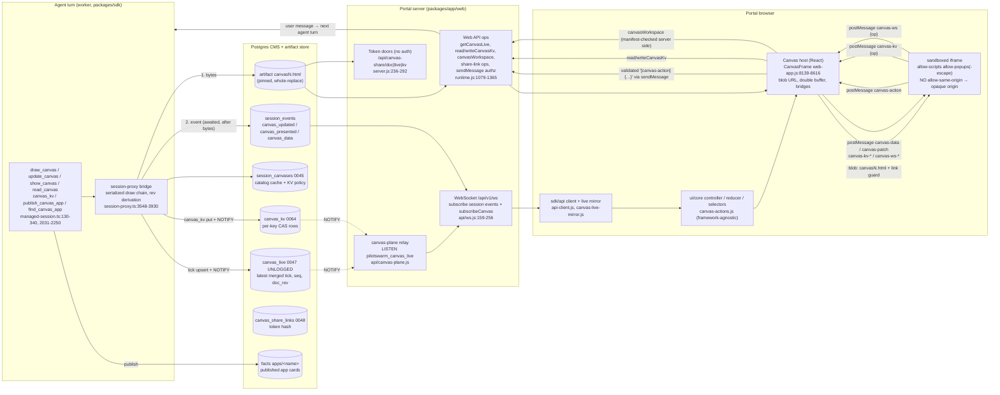

# Research 03: Canvas

Status: research, read-only investigation of branch `dev` (HEAD `2a50ca25`), 2026-10-30.
Question: can the session canvas move to a redesigned portal frontend (React + Tailwind, Next.js, or another stack), or can it be dropped?

**Short answer: carry it forward. Rework the host UI, and change nothing in the platform or the page protocol.** Almost all of canvas lives below the UI layer. The only React-specific part is the "canvas host": about 1,100 lines of components in `web-app.js` and `App.jsx`. That host speaks a postMessage protocol which is already baked into every stored canvas and published app, so a new frontend must reproduce the protocol exactly. It does not need to reproduce the React code.

Citations are `path:line` relative to the repository root.

---

## 1. What a canvas is, in plain language

A canvas is a live web page that the agent draws for you beside the chat. You get a dashboard, a chart, a diagram, a sign-off form, or a small app instead of a wall of text. The agent can keep updating it while it works, and you can click inside it to answer the agent.

- **One session, up to five canvases.** Each slot is a complete HTML document. Slot 1 is `canvas.html`; slots 2–5 are `canvas2.html` … `canvas5.html` (`docs/architecture/canvas.md:3-8`, `packages/sdk/src/canvas-support.ts:13-18`). Sub-agents get their own canvases (`docs/architecture/canvas.md:258-260`).
- **It persists.** A canvas survives reloads, context regeneration, and worker moves, because it is one pinned artifact plus a durable `session.canvas_updated` event (`docs/architecture/canvas.md:15-33`).
- **It is the agent's default visual output.** The base system prompt tells every agent: when the user asks to *see* something, draw a canvas (`packages/sdk/plugins/system/prompts/base-v2.md:83-107`).
- **It can be interactive and shared.** Three lanes carry data (`packages/sdk/plugins/system/skills/canvas-apps/SKILL.md:12-27`):
  - **Ticks**: agent to page, live data updates.
  - **Actions**: page to agent; a button press becomes a structured message.
  - **KV**: shared state that several viewers write, live and attributed.
- **It can use your files.** A canvas app can read and write workspace files, and run commands that the agent declared in its manifest, without spending an agent turn. Examples are a git-history browser and a notes editor (`docs/user-guide/workspaces.md:242-249`, `packages/sdk/src/canvas-workspace.ts:1-33`).
- **It can be shared.** You can send a signed-in deep link that opens the canvas full screen and can hide the portal chrome. You can also send a no-sign-in, read-only public link (`docs/user-guide/portal.md:269-281`).
- **It can be reused.** An app can be saved and published to a deployment-wide catalog, and any session can find and redraw it (`docs/architecture/canvas.md:165-231`).
- **It can be pinned to MoA dashboards.** A canvas panel stays bound to its session and slot (`docs/user-guide/master-of-agents.md:35-39, 80-85`).

**User value.** Canvas turns PilotSwarm from a chat log into a workbench. Long-running watcher, ops, and research agents keep a standing "what is going on" surface current. That surface replaced the retired session-summary mechanism (`docs/architecture/canvas.md:3-8`).

There is real production evidence. A release sign-off on the chk cluster ran a 41-item approver form on a canvas for 5 days: 62 redraws, about 10 MB of document versions. That workload is the reason the KV and multi-approver features exist (`docs/proposals/interactive-canvas-apps.md:89-135`). Of all the portal's features, canvas is the most clearly unique to PilotSwarm.

---

## 2. Architecture and data flow

Each surface works as follows:

- **Draw.** Bytes are written before the event, inside a per-session serialized chain. A revision is only advertised once both exist (`docs/architecture/canvas.md:28-33`). The tool result is an "interface card" (rev, size, manifest summary, effective contract) and never contains the HTML (`packages/sdk/src/managed-session.ts:2078-2110`).
- **Tick.** Data goes to `canvas_live` as an RFC 7386 merge patch inside the upsert's row lock (`packages/sdk/src/cms-migrations.ts:9673-9740`). It is followed by `NOTIFY`. The relay is a stateless fan-out, so any number of relays work (`packages/app/web/api/canvas-plane.js:4-24`). Browsers apply contiguous patches and resync on any gap (`packages/sdk/api/src/canvas-live-mirror.js:1-19`). Ticks are rate-limited to one per 100 ms per slot at the source (`packages/sdk/src/session-proxy.ts:2529`). During migration they are dual-written to durable events (`session-proxy.ts:3735-3800`).
- **Render.** The host fetches `canvasN.html` through the authenticated artifact download. It re-types the bytes as `text/html;charset=utf-8`, injects a link guard after the doctype, and loads the result as a `blob:` URL (`packages/app/ui/react/src/web-app.js:3191-3221`). The iframe is sandboxed without `allow-same-origin`, so its origin is opaque (`web-app.js:8579-8585`).
- **Act.** The page posts `{type:"canvas-action"}`. The host checks that the message came from the live frame's `contentWindow` (`web-app.js:8199-8220`). The core then validates against the current revision's contract, rate-limits to 3 per 3 s, and sends `"[canvas-action] {json}"` as a queued user message (`packages/app/ui/core/src/controller.js:6103-6132`, `packages/app/ui/core/src/canvas-actions.js:53-147`). The server refuses the action unless the sender may write the session (`packages/app/web/runtime.js:1079-1103`). The chat pane hides these messages; the TUI and the activity feed label them (`packages/app/ui/core/src/history.js:740-756, 1455-1470`).
- **KV.** The page sends `canvas-kv {id, op}`. The host calls `readCanvasKv` or `writeCanvasKv` for its own frame's session and slot. The server stamps `by` and `at`. Changes come back as `canvas-kv-change` (`web-app.js:8221-8271, 8370-8389`). All rules live in one place, `packages/sdk/src/canvas-kv.ts:133-360`.
- **Files and commands (canvas-ws).** The page sends `canvas-ws {id, op}`. The host forwards it to `canvasWorkspace`, which checks each call against the manifest's `workspace` block in the drawn document (`web-app.js:8272-8331`, `packages/sdk/src/canvas-workspace.ts:1-33, 246-361`). This is owner-only (`packages/sdk/api/src/protocol.js:137`).

---

## 3. Every user-facing interaction and its current entry point

| # | Interaction | Entry point today | Code |
|---|---|---|---|
| 1 | Ask the agent to draw or update | Plain chat ("show me…"); agent decides | `base-v2.md:83-107` |
| 2 | Canvas opens by itself on a fresh draw or `show_canvas` | Auto "flip" of the side pane for the **active** session only; skipped if stale or if you closed that slot by hand | `controller.js:6052-6083, 6210-6222` |
| 3 | Open/close the canvas | Toolbar **Canvas** button (desktop: side column; phone: layer over chat, the only way in or out) | `web-app.js:10649-10680`, `MobileCanvasLayer` `web-app.js:7597-7618` |
| 4 | "Canvas changed while hidden" badge | Toolbar badge with three states; session-row marker (outline, or outline plus dot) | `web-app.js:10673-10679`, `SessionCanvasMark` `web-app.js:7831-7847`, `selectors.js:3500-3526` |
| 5 | Switch between slots | `‹ select ›` in pane header, shown only when there is more than one drawn slot | `CanvasSlotControls` `web-app.js:8073-8105` |
| 6 | Canvas vs Workspace in the same pane | Tabs in the side-pane header | `SidePaneTabs` `web-app.js:8647-8663`; `workspaces.md:184-186` |
| 7 | Zoom | `HtmlZoomControl` in pane header (desktop only) | `web-app.js:8800` |
| 8 | Zen (chat rail + canvas) | Pane header button | `web-app.js:8810-8818`; `reducer.js:3537-3547` |
| 9 | Full screen | Pane header button; controls move into the portal header | `web-app.js:8820-8835, 8760-8790` |
| 10 | Phone maximize | Rev strip button | `web-app.js:8758-8766` |
| 11 | Click inside the canvas (action) | Agent-authored buttons; hidden from chat, shown as a collapsed "canvas" notice | `web-app.js:8212-8219`, `CanvasActionLine` `web-app.js:1640-1657` |
| 12 | Edit shared app state (KV) | Inside the app; who can edit is set in the Share dialog | `web-app.js:8007-8030` |
| 13 | App uses session files / runs declared commands / downloads | Inside the app; download needs a click inside the canvas | `web-app.js:8278-8331` |
| 14 | Share: session deep link | Pane header link icon opens **Share canvas** dialog, **Session access** tab; optional "Hide page chrome" | `CanvasShareDialog` `web-app.js:7878-8066`; deep-link parse `packages/app/web/src/lib/deep-link.js:35-66` |
| 15 | Chrome-less landing | `?view=canvas&slot=N&max=1&show_chrome=false`, with a faint "Show chrome" strip | `App.jsx:583-600, 648-661, 701-710` |
| 16 | Share: public, no sign-in, read-only | **Anyone with link** tab: create, reset (old link dies), remove; token shown once | `web-app.js:8034-8054`; viewer `CanvasShareView` `App.jsx:749-929` |
| 17 | MoA canvas panel | Panel picker (`Session chat` or `Canvas N · name`), then pinned panel; "Focus panel" maximizes the canvas | `MoaWorkspace.jsx:290-306, 582-586, 715-730` |
| 18 | Recovery states | "Couldn't load rev N", Retry; "opened another page" with "Show the canvas again"; broken-manifest notice; empty-state teaching copy | `web-app.js:8590-8615, 8861-8864` |
| 19 | TUI | No rendering. A `[canvas] rev N` activity line and an `artifact://…/canvas.html` link that the press-a picker can open | `history.js:1163-1184, 1441-1453, 1498-1508` |

Preferences persist per user and roam with the profile, merged max-wins across devices: last viewed rev and dataRev, plus the per-slot opt-out (`reducer.js:133-170, 1159-1161`). Pane open, zen, and side-tab state also roam (`web-app.js:520`).

---

## 4. Coupling analysis and the contract a new frontend must implement

### 4.1 Where the code lives, by layer

| Layer | Files | Framework coupling | Carries over as-is? |
|---|---|---|---|
| Agent tools and bridge | `managed-session.ts:130-340, 2031-2250`; `session-proxy.ts:3548-3930`; `canvas-support.ts`, `canvas-app-manifest.ts`, `canvas-app-catalog.ts`, `canvas-kv.ts`, `canvas-workspace.ts` | None | Yes |
| Storage | migrations 0045 (`cms-migrations.ts:9564-9600`), 0047 (`:9673-9740`), 0048 (`:9749-9765`), 0064 (`:13901`) | None | Yes |
| Portal server | `api/canvas-plane.js`; `api/ws.js:27-256`; `server.js:94, 236-292, 374-382`; `runtime.js:317-321, 742-743, 1079-1103, 1298-1365, 1659-1770` | Express + `ws` + `pg`, no UI | Yes, if Express stays (see 4.4) |
| Web API contract | `packages/sdk/api/src/protocol.js:117-137` | None | Yes |
| Browser transport | `sdk/api/src/api-client.js:323, 535, 599-610`; `http-api-transport.js:638-746`; `canvas-live-mirror.js` | Plain JS | Yes |
| UI state | `ui/core/src/canvas-actions.js`, `reducer.js:3457-3560`, `selectors.js:3500-3620`, `controller.js:2847-2899, 5935-5941, 6044-6260, 6342-6464`, `history.js` | Plain JS, shared with TUI | Yes |
| **Canvas host (React)** | `CanvasFrame` `web-app.js:8139-8616` (~480 lines); `CanvasPane` `:8665-8877`; `CanvasShareDialog` `:7878-8066`; `CanvasSlotControls` `:8073-8105`; `MobileCanvasLayer` `:7597-7618`; glyphs and marks `:7789-7858`; toolbar entry `:10649-10680`; `fetchArtifactHtmlObjectUrl` `:3191-3221`; `CanvasShareView` `App.jsx:749-929`; `PinnedCanvas` `MoaWorkspace.jsx:582-586`; 153 canvas CSS lines in `web/src/index.css` | React (`createElement`, hooks, portals) | **Rewrite or port** |
| Page-side protocol | Helpers that agents paste into pages: `skills/canvas-apps/SKILL.md:78-90, 316-321`; `skills/html-visuals/SKILL.md:58, 129, 156, 188-215` | None, but **frozen**: embedded in stored artifacts and published apps | Must be preserved byte-for-byte |

**Conclusion: canvas is protocol- and iframe-based, not React-based.** The React host is a thin, dense adapter between the `ui/core` controller and a sandboxed iframe. Two facts show the host is already reusable:

- MoA reuses the same `CanvasFrame` export (`web-app.js:16516`, `MoaWorkspace.jsx:4, 585`).
- The public share viewer is an independent, roughly 180-line host with no controller at all (`App.jsx:749-929`). That is a working reference implementation of the minimal host.

The most important constraint is not in the UI. The message names and shapes in the canvas-apps and html-visuals skills are compiled into every canvas already drawn and every app published to the catalog. A new host that renames `canvas-kv-ready`, or changes `{type:"canvas-data", data, dataRev}`, breaks them silently.

### 4.2 The Canvas Host Contract (what a new frontend must implement)

**A. State and discovery** (reuse `ui/core` and `sdk/api` unchanged)

1. Seed slot summaries from session list rows (`row.canvases`) (`controller.js:2847-2857`). On select, after a 160 ms settle, call `ensureCanvasSnapshot`; it is memoized and runs only while the pane is visible (`web-app.js:8689-8698`, `controller.js:6134-6200`).
2. Feed session events into the controller: `session.canvas_updated`, `session.canvas_presented`, `session.canvas_data`, `session.canvas_kv`, `session.canvas_plane_released` (`controller.js:6342-6360, 6452-6464`). Keep the `subscribeCanvas` WebSocket and the live mirror (`http-api-transport.js:638-746`).
3. Read the view through `selectCanvasView`, which is memoized for render stability (`selectors.js:3533-3620`), and `sessionCanvasMark`.

**B. Document loading** (`web-app.js:3191-3221, 8391-8616`)

4. Fetch `canvas.html` or `canvas{N}.html` through `downloadArtifactResponse`. Force `text/html;charset=utf-8`. Insert the link-guard script after the doctype prolog. Add the panel-key bridge only for dashboard tiles.
5. iframe: `sandbox="allow-scripts allow-popups allow-popups-to-escape-sandbox"` (**never** `allow-same-origin`), `allow="autoplay *"`, `referrerpolicy="no-referrer"`, and a `data-session` tag.
6. **Double buffer.** Load each new revision in a staging frame stacked under the live one. Promote on `load` by z-order only. Revoke superseded blob URLs.
7. **Keep alive.** Never unmount or `display:none` a hidden canvas. Park it off-screen with `inert`, otherwise app state is lost and iOS breaks touch scrolling (`web-app.js:7603-7613, 8841-8860`).
8. **Resize policy.** Never reload on resize. The single exception is one settle-reload when the page first loaded against a degenerate box (under 220×170) (`web-app.js:8517-8555`).
9. Detect a "left page" navigation (a second `load` on the live frame) and stop serving bridges to it (`web-app.js:8588, 8590-8598`).

**C. Wire protocol (frozen)**

| Direction | Message |
|---|---|
| host → page | `canvas-data {data, dataRev}`, sent on every promote and every tick (replay to new documents); `canvas-patch {patch, dataRev}`, which never travels without `canvas-data` (`web-app.js:8477-8504`) |
| page → host | `canvas-action {action, data}`, accepted from the live frame only |
| page → host | `canvas-kv {id, op: ready\|get\|list\|put\|delete, key?, value?, ifMatch?, prefix?, after?, limit?}`; reads allowed from staging, writes from live only |
| host → page | `canvas-kv-ready {entries, nextAfter, me, canWrite, policy}`, `canvas-kv-result {id, ok, …}`, `canvas-kv-change {key, rev, op, v?, by?, at?}` |
| page → host | `canvas-ws {id, op: info\|list\|stat\|read\|write\|mkdir\|move\|delete\|zip\|watch\|run\|download, …}`, with fields whitelisted (`web-app.js:8135-8137`) |
| host → page | `canvas-ws-result {id, ok, result\|error, code}`, `canvas-ws-change {reason: agent\|owner\|canvas}` |
| page → host | `moa-panel-key {key, backwards}`, dashboard tiles only |

**D. Rules the host enforces**

10. **Provenance.** `event.source` must be the live (or, for reads only, staging) frame's `contentWindow` for **this** session (`web-app.js:8199-8207`).
11. **Actions.** Validate against the *current revision's* contract with `validateCanvasAction`, rate-limit, and send the `[canvas-action] ` prefix with `enqueueOnly` (`controller.js:6103-6132`). The server re-checks write permission.
12. **Downloads.** Require `navigator.userActivation.isActive` and the canvas frame to hold focus (`web-app.js:8301-8307`).
13. **Viewed and unseen.** Only a promote or data injection while visible dispatches `canvas/viewed`. Mode changes never mark anything viewed (`web-app.js:8458-8466, 8500-8516`).
14. **Auto-present guards.** Flip only for the active session, a fresh event, and a slot the user has not closed by hand (`controller.js:6052-6083`).
15. **Workspace watchers.** Tell watching pages about agent tool completions and portal file edits, debounced (`web-app.js:8336-8368`).

**E. Sharing and routing**

16. Signed-in deep link: `?session=&view=canvas&slot=&max=1[&show_chrome=false]`. Keep `show_chrome` across the sign-in stash (`deep-link.js:35-131`, `canvas-share-chrome.test.mjs:1-9`).
17. Public viewer: `?canvasShare=<token>` renders a standalone, unauthenticated host. It fetches `/api/canvas-share/doc|live|kv`, subscribes on a share-scoped WS, refuses KV writes with `FORBIDDEN`, and drops actions (`App.jsx:749-929, 954-960`).
18. Share management ops: `getCanvasShareLink`, `resetCanvasShareLink`, `removeCanvasShareLink`, `setCanvasKvAccess` (`protocol.js:126-129`).

### 4.3 Tests and how portable they are

About 160 canvas test cases exist. Counts are `it`/`test` occurrences per file:

- SDK unit (all portable): `canvas-tools` 44, `canvas-workspace` 29, `canvas-kv` 16, `canvas-app-manifest` 14, `canvas-live-mirror` 10, `canvas-app-catalog` 9.
- SDK local integration (portable): `canvas-plane` 15, `canvas-kv` 3, `canvas-app-catalog` 1.
- `ui/core` (portable): `canvas-actions` 16, `canvas-state` 17, `canvas-plane-takeover` 8, `canvas-action-transcript` 7, `canvas-view-identity` 2.
- Web server (portable): `canvas-plane-relay` 8, `canvas-share` 15.
- Playwright e2e: `canvas-workspace.spec.mjs` (8). It drives the real skill helper against a stub server (`canvas-workspace.spec.mjs:22-24`). It is portable if the new UI keeps equivalent roles and labels. 23 e2e specs mention canvas.
- **Not portable:** source-text assertions that `readFileSync` `web-app.js`, `App.jsx`, `runtime.js` or `index.css` and regex-match them (`canvas-share-chrome.test.mjs:22-25`, `canvas-action-authz.test.mjs:20, 55`, `canvas-share.test.mjs:13-14`). These must be rewritten as behavior tests against the new host. That is worth doing anyway.

### 4.4 Effort estimate (one engineer who knows the codebase, parity scope)

| Work item | React + Tailwind (Vite SPA) | Next.js (client components) | Non-React (Svelte/Vue/Solid) |
|---|---|---|---|
| Canvas host: loader, double buffer, keep-alive, 3 bridges, viewed receipts | 3–4 d (mostly a port of `CanvasFrame` to TSX) | 3–4 d, plus `"use client"` and no-SSR iframe | 5–7 d (re-express about 10 effects) |
| Pane chrome: slot switcher, zoom, maximize/zen, empty/error states, mobile layer | 3–4 d | 3–4 d | 4–5 d |
| Share dialog + chrome-less landing + deep-link wiring | 2 d | 2–3 d (router integration) | 2–3 d |
| Public share viewer | 0.5 d (keep the current standalone) | 1 d (route `/c/[token]`) | 1 d |
| Dashboard tile (MoA) + session-row marks + toolbar badge | 2 d | 2 d | 2–3 d |
| Replace source-grep tests with behavior tests; port e2e selectors | 3 d | 3 d | 3–4 d |
| Hardening (see §5, S1): CSP for canvas documents | 1–2 d | 1–2 d | 1–2 d |
| **Total** | **~3 engineer-weeks** | **~3–3.5 weeks** | **~4–5 weeks** |

Assumptions:

- `ui/core`, `sdk/api`, and the Express server stay as they are.
- **If Next.js also replaced the Express server**, the plane relay will not fit request-scoped or serverless route handlers: it needs a long-lived `pg` `LISTEN` connection and a WebSocket fan-out (`canvas-plane.js:26-156`, `ws.js`). Keep the existing Node server for `/api/*` and WS, and use Next.js only as the UI shell. Otherwise add about 1–2 weeks for a separate relay service.

---

## 5. Weaknesses in today's canvas experience

**UX and discoverability**

1. **No user-facing canvas guide.** The user guide covers canvas only in passing: share (`portal.md:269-281`), files (`workspaces.md:242-249`), and MoA panels. Slots, actions, KV, zen, badges and auto-open are documented only in the architecture doc (`docs/architecture/canvas.md`). Users learn about canvas when an agent happens to draw one.
2. **Too many overlapping presentation modes.** There are at least eight: side column open/closed, Canvas vs Workspace tab, zen, full screen (with controls moved into the portal header through a DOM-id poll, `web-app.js:8706-8718`), artifact-reader precedence, phone inset vs phone maximized, chrome-less share, and MoA focus. Each has its own exit control, and some deliberately omit a ✕ (`web-app.js:8820-8826`). Users have to learn the hidden rule "the toolbar Canvas button is the way out" (`web-app.js:7585`, `8627`).
3. **Canvas and Workspace share one pane.** The files browser lives as a tab inside the "canvas" side pane, which you open with the canvas button (`workspaces.md:184-186`, `web-app.js:8647-8663`). The two concepts are unrelated, and the label hides where Files are.
4. **Slots are nearly invisible.** The switcher renders only when more than one slot is drawn (`web-app.js:8073-8076`). Unnamed slots read as "canvas 3", and an unseen slot is marked with a bullet inside a `<select>` option (`web-app.js:8082`). There is no overview of a session's canvases and no thumbnails.
5. **Developer jargon on screen.** The header label is "`name · rev 4`" (`web-app.js:8742, 8766, 8796`). The agent's revision note appears only as a tooltip (`title: view.note`). No revision history can be browsed; the v1 non-goal is still in force (`docs/proposals/session-canvas.md:92-101`).
6. **Failures inside the canvas are silent.** A rejected action (no contract, rate-limited, forbidden for read-only viewers) only reaches `console.warn` (`web-app.js:8214-8217`). The user clicks a button and nothing happens. Only the agent's page, if it handles results, could explain.
7. **Auto-open is surprising and its opt-out is hidden.** A fresh draw flips the pane open. Closing it by hand silences that slot only, invisibly, until you reopen it (`controller.js:6070-6072`, `reducer.js:3465-3487`). Nothing on screen tells the user that a canvas will no longer auto-open.
8. **The share dialog mixes three decisions.** It holds audience (session vs public), presentation ("Hide page chrome", which is cosmetic), and **edit policy** for the app's KV store (a three-way `<select>`) in one modal (`web-app.js:7966-8066`). The public token can be shown only once (`web-app.js:8040-8047`). A link created on another device cannot be re-copied, only reset.
9. **The empty state is generic.** "Nothing on the canvas yet. Ask the agent to draw…" (`web-app.js:8861-8864`) appears even in sessions whose agent never draws. There is no example prompt and no catalog to browse; portal browse is designed but unshipped (`docs/architecture/canvas.md:229-231`).
10. **The TUI is a second-class viewer.** It shows only a `[canvas] rev N` line. Its artifact link is hard-coded to `canvas.html` whatever the slot (`history.js:1450`; the slot is not carried in `buildCanvasChatItem`), so slots 2–5 likely open slot 1's document. I inferred this from the code and did not reproduce it.
11. **Accessibility depends on agent-authored HTML.** Every frame's title is "Session canvas" (`web-app.js:8577`) or "Shared canvas" (`App.jsx:924`). Contrast, focus order and semantics are whatever the agent wrote; the html-visuals skill teaches some rules (`html-visuals/SKILL.md:188-215`) but nothing checks them.

**Security and correctness (important for any rewrite)**

- **S1. The "no network" sandbox rule is not enforced.** The html-visuals skill says a network call produces a broken page (`html-visuals/SKILL.md:188-195`), and the architecture doc says the rules are "enforced by the sandbox" (`docs/architecture/canvas.md:266-271`). But:
  - The in-portal canvas is a `blob:` document with no CSP injected (`web-app.js:3197-3221`).
  - The portal serves no CSP header. The only CSP in the codebase is on the public share doc route, and it is `sandbox allow-scripts` with no `connect-src` or `img-src` (`server.js:250`, confirmed by `git grep`).
  - An opaque-origin frame can still `fetch` CORS-open hosts, load remote images, and open popups that escape the sandbox.

  Owner-only `canvas-ws` lets a page read workspace files (`canvas-workspace.ts:1-33`). An agent-authored page, possibly shaped by prompt-injected content, therefore has a data-egress path. This conclusion comes from reading code; I did not test it live.

  **Recommendation:** have the new host inject `<meta http-equiv="Content-Security-Policy" content="default-src 'none'; script-src 'unsafe-inline'; style-src 'unsafe-inline'; img-src data: blob:; media-src data: blob:; font-src data:">` first in `<head>`. Mirror it in the share-doc header. Longer term, serve canvases from a dedicated sandbox origin.
- **S2. The docs disagree with the code on who may send actions.** `docs/architecture/canvas.md:119-125` says creator-only. The server allows owner, admin, or anyone with session write (`runtime.js:1091-1103`), and the client comment agrees with the server (`controller.js:6107-6114`). The rewrite should treat the code (Part E) as the truth and fix the doc.

---

## 6. Recommendation

### Verdict: **Carry forward. Rework the host UI; freeze the protocol.**

Reasons:

1. **It is the product's differentiator and is load-bearing.** The default prompt makes canvas every agent's primary visual output (`base-v2.md:83-107`). A real multi-day release workflow ran on it (`interactive-canvas-apps.md:89-135`). Dropping it would regress every session that draws, and would orphan stored canvases and published catalog apps.
2. **About 85–90% of it is frontend-independent.** Tools, storage, relay, Web API, transport, live mirror, and the state machine are all plain JS or TS outside the React package (§4.1). A new frontend inherits them for free.
3. **The React-specific part is small and well specified.** About 1,100 lines of host, with the reasoning written into its comments. A minimal working host (`CanvasShareView`) already exists outside the main app. Parity costs about 3 engineer-weeks on a React-family stack (§4.4).
4. **The redesign is the right moment to fix its real problems.** Those are mode sprawl, the Canvas/Workspace conflation, invisible slots, silent failures, the overloaded share dialog, and the missing CSP (§5). None of them requires changing the agent-facing tools or the page protocol.

Non-negotiables for the rewrite:

- the postMessage contract in §4.2-C, unchanged;
- sandbox without `allow-same-origin`;
- double-buffered, keep-alive frames;
- server-side authorization left where it is.

Add the CSP (S1) as part of the port.

### Where canvas should sit in a redesigned information architecture

Treat a canvas as a **first-class object of a session**, like the transcript and the files, rather than a mode of a side pane.

| Placement | Proposal | Replaces today |
|---|---|---|
| **Session view: split pane (default)** | When a session has a canvas, the session view is Chat on the left and Canvas on the right, with a resizable divider. A **canvas strip** above the canvas holds a named tab for each slot: thumbnail or name, "updated" dot, rev in a secondary popover. An overflow menu holds Share, Open full, Zoom, and History (future). One close (×) and one "pop out" control. | Toolbar toggle + side column + hidden slot select + zen |
| **Session view: tabs (narrow, phone)** | Segmented control **Chat · Canvas (n) · Files · Activity** in the session header. Canvas is a tab, not a layer, so back and swipe work naturally. Keep the frames mounted across tab switches. | Mobile canvas layer + "toolbar is the only way out" |
| **Files separated** | Workspace files get their own tab or route; a canvas app that uses files shows a small "uses files: work/**" chip from its manifest. | Canvas/Workspace tabs inside one pane |
| **Full workspace route** | `/s/:sessionId/canvas/:slot`: the canvas fills the content area with a slim chat drawer (today's zen). This is also the target of the signed-in share link; `show_chrome=false` maps to an even slimmer header. | Full screen + zen + `max=1` |
| **Dashboard tile** | MoA tiles keep `{type:"canvas", sessionId, slot}` bindings (`ui/core/src/moa.js:21-23`). Add a live mini-render or static thumbnail, plus an "updated" dot. | `PinnedCanvas` |
| **Share view** | Keep a standalone, unauthenticated route (`/c/:token` or the current `?canvasShare=`) as its own tiny bundle, with no portal code. Split the share dialog into **Link** (session / public) and **Permissions** (who can edit the app). Put the edit policy in the app's own settings popover, where users look for it. | `CanvasShareDialog` tabs + KV select |
| **Discovery** | A "Canvases" index, either global or in the sessions sidebar, listing recent canvases across your sessions with thumbnails and unseen dots, plus a browse view of the published app catalog (`find_canvas_app` already exists; `canvas-app-catalog.ts:154`). | Nothing; row marker only |
| **Feedback** | Surface rejected actions as a toast anchored to the canvas ("This canvas didn't accept that click: view-only access"). Show a visible "auto-open off for this canvas" state with a toggle. | `console.warn`, invisible opt-out |
| **TUI** | Keep text-only. Fix the slot-aware link (`history.js:1450`) and print the slot name. | — |

Suggested next steps for the redesign track:

1. Write the §4.2 contract as a typed `CanvasHost` interface (TS) plus a protocol conformance test page that exercises every message type. Run it against both the old host and the new one.
2. Port `CanvasFrame` first, behind the new shell, and keep `ui/core` untouched.
3. Land the CSP injection (S1) and the doc fix (S2) in the current portal now. Both are independent of the redesign.
