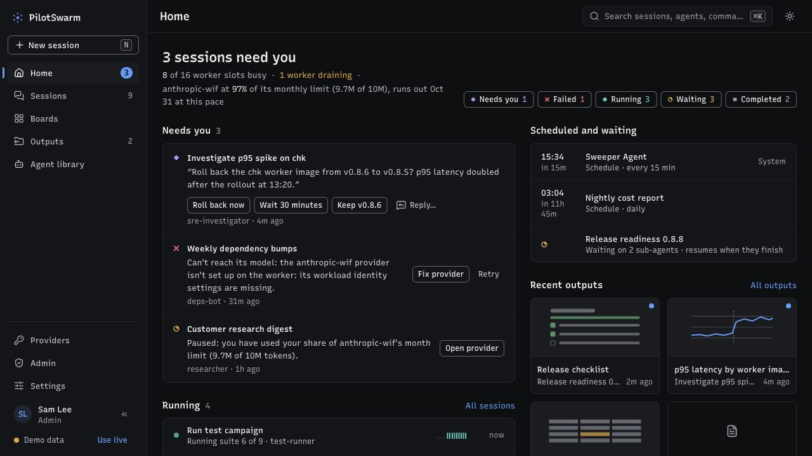
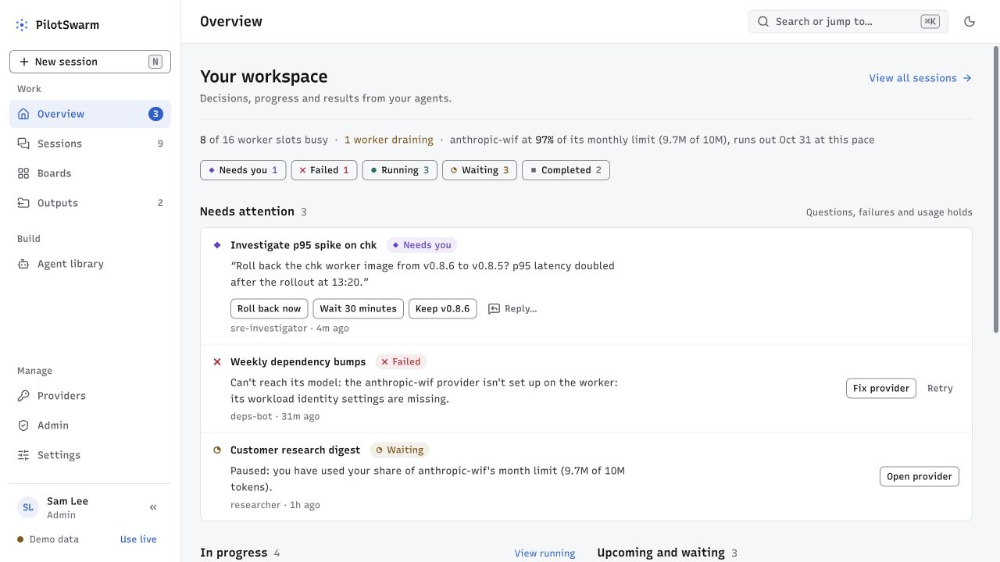
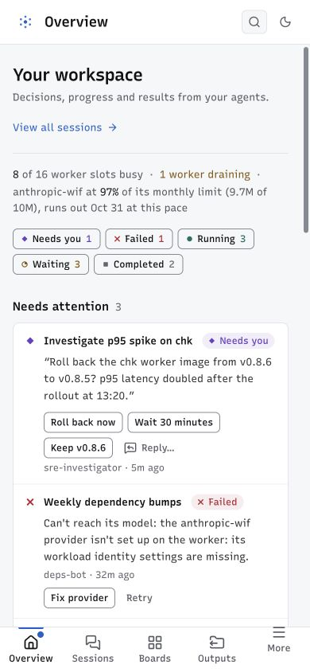

# Flight Deck UX audit and implementation — 30 October 2026

Flight Deck now has a clearer attention-first overview, grouped navigation,
more useful session/output cards, safer interaction feedback, and a deliberate
first-session experience. The existing neutral visual system was retained;
state and next action carry the emphasis. This is a code-led **Operate** surface,
not a marketing page or a new visual identity.

Implementation is limited to the Flight Deck frontend, its fixtures, tests,
assets, and documentation. Runtime SDK, backend, API contracts, and database
schemas are unchanged. The classic portal and native TUI were not redesigned.
See [API and SDK triage](api-sdk-triage.md) for separately classified integration
work and proposed contract improvements.

## Method and evidence

- Captured the running app in an in-app browser before editing, using
  both the live empty deployment and explicitly labeled demo data.
- Three independent design agents assessed information architecture, interaction
  safety/accessibility, and the shell/visual system. Their recommendations were
  cross-reviewed and reconciled against the actual code and public API catalog.
- Used product-design audit guidance and operational-UI craft standards.
  Immersive-design ideas were constrained to a useful onboarding asset; routine
  operational work has no decorative 3D or background animation.
- Ran the deterministic design detector, then inspected rendered desktop and
  mobile states. Detector success is not a visual or accessibility signoff.
- Demo content illustrates populated states; it is not evidence that real
  agents completed those tasks or that production permissions were exercised.

## Captured journey and health

| Step | User task | Before | Implemented evidence and health |
| --- | --- | --- | --- |
| 1 | Understand the empty workspace | [Live first visit](before/01-home-live.jpg) | [Dark](after/06-onboarding-dark.jpg), [light](after/07-onboarding-light.jpg): clear first action, durable-work explanation, restrained original artwork. **Improved.** |
| 2 | Decide what needs attention | [Populated Home](before/02-home-demo.jpg) | [Overview desktop](after/19-overview-final-desktop.jpg): full-width attention queue, visible state labels, shared counts, secondary work/waiting sections. **Improved.** |
| 3 | Navigate and triage on a phone | No accepted baseline phone capture | [More navigation](after/03-mobile-navigation.jpg), [390px overview](after/16-overview-mobile-confirmed.jpg), [320px overview](after/17-overview-320.jpg): grouped navigation and readable wrapping. **Improved; final 390px and 320px DOM checks found no document or main overflow.** |
| 4 | Find and select sessions | [Sessions](before/03-sessions.jpg) | [Selection](after/12-session-selection.jpg): independent checkbox targets, clear selection bar, Mine/Others/All ownership semantics. **Improved; ownership and partial-result rules tested.** |
| 5 | Read or contribute to a session | [Chat and canvas](before/04-session.jpg) | [View-only mobile](after/15-view-only-mobile.jpg): explicit reason with disabled composer. Per-session draft/send isolation and retry behavior were source-checked and unit-tested. **Improved; live mutations not exercised.** |
| 6 | Arrange a personal monitoring board | [Populated board](before/05-boards.jpg) | [Intentionally empty board](after/10-board-empty-persisted.jpg): clear Add tile action and browser-storage explanation. **Improved; clearing a board no longer triggers automatic reseeding.** |
| 7 | Scan the fleet | Source inspection of incumbent Fleet cells | [Fleet](after/11-fleet.jpg): visible state words, task summary, waiting/next-run detail, urgency order. **Improved.** |
| 8 | Find produced work | [Outputs](before/06-outputs.jpg) | [Desktop](after/05-outputs-desktop.jpg), [mobile](after/04-outputs-mobile.jpg): truthful cards, type/update/session context, filtering and explicit history scope. **Improved; full-history discovery remains bounded.** |
| 9 | Choose an agent by capability | [Agent library](before/07-library.jpg) | [Search and expanded capabilities](after/08-library-search-capabilities.jpg): task-oriented introduction, tool/skill search, full capability disclosure, clear Start action. **Improved.** |
| 10 | Investigate model access and usage | [Providers](before/08-providers.jpg) | [Usage drawer](after/09-provider-usage.jpg): honest connectivity status, explicit aggregate scope, dates/total/peak, accessible daily values. **Improved; provider-filter integration remains.** |
| 11 | Review platform access information | [Admin overview](before/09-admin.jpg) | [Access and audit](after/13-access-audit.jpg): example policy labeled as demo; live policy is not guessed. Reported cluster measures use known fields/units. **Improved; adapter fallbacks limit error distinctions.** |
| 12 | Prepare a new session | [Task-first sheet](before/10-new-session.jpg) | [320px form](after/18-new-session-320.jpg): task-first structure retained; loading/error recovery and in-flight guards added. **Form reflow verified; no credentialed session creation was performed for this audit.** |

## Highest-impact findings and fixes

| Priority | Original problem | Implemented response |
| --- | --- | --- |
| P1 | “Mine” was inferred from private visibility, excluding an owner's shared sessions. “Shared with me” overstated what owner mismatch proved. | Filter by normalized ownership; label the other-owner scope **Others**; keep unknown ownership explicit. Canonical effective access remains integration triage. |
| P1 | Failed session/catalog reads could become misleading first-run, empty, or missing-session screens. | Explicit error/retry and stale-data messages on key surfaces; distinguish missing from failed detail reads. Remaining swallowed adapter errors are documented. |
| P1 | Mutation controls could accept repeated input; draft/queue state could cross session boundaries; read-only hints were inconsistent. | Immediate in-flight latches, session-scoped composer memory, revision-aware completion, explicit view-only feedback, and failed bulk targets retained for recovery. |
| P1 | Admin/provider copy asserted authentication posture, connectivity, health, or common failure causes without supporting data. | Show only reported/known facts; identify unknown values and example policy; remove invented readiness and same-cause claims. |
| P2 | A fixed secondary column competed with attention work; phone navigation and long titles needed clearer grouping/wrapping. | Full-width attention section, proportional secondary content, Work/Build/Manage navigation groups, bounded mobile corrections. |
| P2 | Output previews implied specific charts/tables from markup heuristics. Fleet cards could communicate state through color/glyph alone. | Replace synthetic previews with honest type/content metadata; add visible state words and useful timing/context. |
| P2 | Clearing every board tile was undone by the next initial-seeding pass. | Seed only an uninitialized board state; preserve deliberate empty layouts. |
| P2 | Agent capabilities were truncated; usage bars lacked visible scope, dates, totals, and a readable data alternative. | Searchable capability disclosure; labeled usage figure with daily-value table and meaningful zero/unknown handling. |

## Representative before and after

Attention work previously competed with the scheduled/output column:

The implemented overview gives decisions the full content width:

The final phone confirmation replaces the earlier overflow-prone intermediate capture:

## Assets and product restraint

Created one original transparent onboarding illustration, expressing coordinated
durable work with task blocks, a document, and a clock. It is decorative, has
empty alt text, and supports explanatory copy rather than representing actual
product output. See [asset provenance and prompt](../../../packages/flightdeck/public/assets/README.md).
The PNG source is approximately 1.3 MB; a smaller delivery format remains a
performance optimization. Existing self-hosted typography, Lucide icons, and
the swarm identity remain. Populated operational cards gain information,
not decorative stock graphics.

## Verification and limits

- Flight Deck build and token checks passed. Eleven ownership/access/composer
  tests and ten session-stream tests passed. The checks cover failure retention,
  write hints, same-session latches, cross-session draft/completion isolation,
  and event handling; they do not establish production acceptance.
- The build retains a bundle-size warning: the main application chunk is
  approximately 610 kB minified (179 kB gzip). Route code splitting and a
  smaller onboarding image are follow-up performance work, not claimed fixes.
- Rendered checks cover desktop, light/dark onboarding, 390px mobile, and a
  320px overview. Final 390px and 320px overflow inspections returned no main/document
  overflow. Mobile view-only composer and desktop checkbox selection were
  inspected in the browser.
- State is visibly named, checkbox interaction is separated from navigation,
  view-only restrictions have reasons, and the usage chart has a table
  alternative. Screenshots and limited interaction checks do **not** establish
  WCAG compliance. Full screen-reader, keyboard-journey, zoom, contrast,
  production-content, and device testing remain acceptance work.
- A blocked session request was attempted for fault injection, but its capture
  remained in loading state. No reliable rendered failure/recovery screenshot
  resulted. Network behavior was restored and live content reloaded. Error
  recovery UI is **source-checked, not browser-proven** by that attempt.
- Loading/cropped captures were rejected. The invalid baseline mobile image
  and the attempted error/loading images are not audit evidence. Intermediate
  mobile capture `after/02-overview-mobile.jpg` is superseded by the final
  390px and 320px confirmations above.
- Existing classic-portal handoffs remain for unported package/app management,
  sharing configuration, provider configuration/defaults/limits, and selected
  admin operations. The UI does not claim these capabilities were completed.
- No live runtime agent execution, backend changes, or deployment were needed
  for UX verification; the onboarding image was generated as requested. See [API/SDK triage](api-sdk-triage.md) for
  the remaining boundary between a polished frontend and complete integration.

## Review disposition

| Independent review | Disposition | Scope / limit |
| --- | --- | --- |
| Visual / art direction | Approved | Reviewed desktop and phone captures plus current source; no blocking visual finding. |
| Interaction / accessibility risks | Approved within integration limits | Cross-reviewed data states, cards, read-only hints and session isolation; no complete WCAG claim. |
| Information architecture | Accepted reviewed evidence | Desktop routes and final mobile captures; source confirmation of the cross-review fixes. |

Independent visual and interaction reviews approved the bounded frontend scope.
The information-architecture review accepted the final desktop/mobile evidence
and confirmed the reported interaction corrections in source. Remaining
integration and accessibility acceptance limits above still apply.

A commit-time review attempted on 30 October produced no signoff (the review tool was not logged in), so this
audit's own conclusions rest on the visual, interaction and information-architecture reviews above. The work was
committed later and reviewed again; see the [1 November record](../2026-11-01/README.md).

Questions skipped: the user explicitly requested an autonomous implementation
without questions. Product assumptions and evidence limits are stated above.
